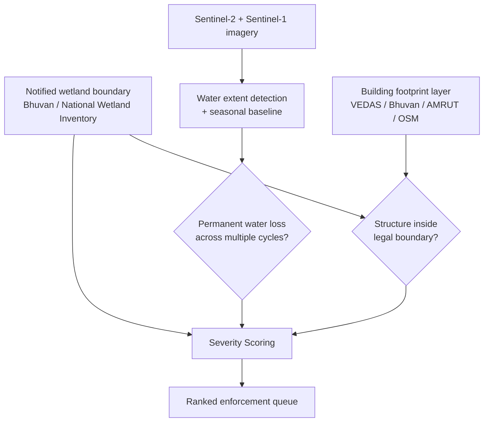
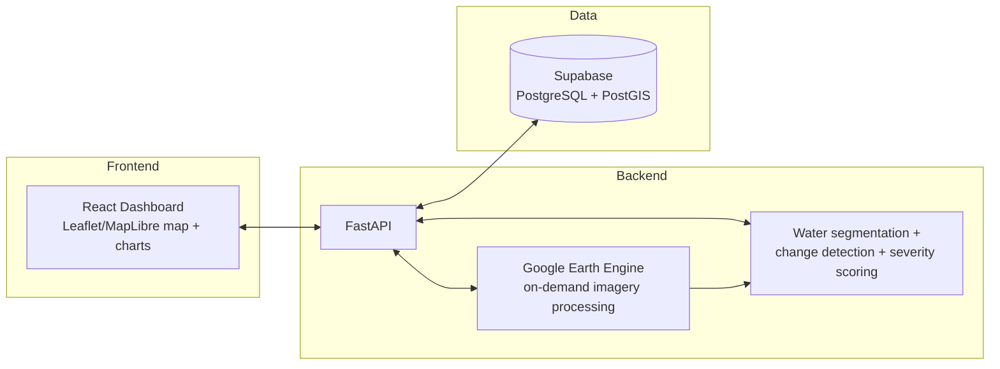

# NeerRikshan

**Wetland Encroachment Detection & Enforcement Prioritiser**

> Status: early / makeshift — this README will evolve as the project develops.

## Overview

India has 2,00,000+ identified wetlands, and encroachment on them is illegal — yet
wetlands keep disappearing through filling, construction, and conversion, usually
surfacing only via a newspaper report or a court case. The legal framework (Wetlands
Rules, District Wetland Authorities) and the enforcement power already exist; what's
missing is a systematic way to detect loss and prioritise which cases to act on.

**NeerRikshan** compares the officially notified boundary of each wetland against
current satellite imagery and building-footprint data to answer three questions per
wetland:

1. Has it actually lost area?
2. Roughly when did the loss happen, and is it permanent or seasonal?
3. How severe is it — and are there structures now standing inside the legal boundary?

The output is not just a map. It's a **ranked enforcement queue** a District Wetland
Authority can act on directly: wetland name, area lost, onset date, and any structures
encroaching on the notified boundary.

## How It Works

1. **Legal boundary** — Start from the government's notified wetland boundary (Bhuvan /
   National Wetland Inventory). This is fixed and doesn't need updating — it's a legal
   reference, not a live observation.
2. **Water detection** — Feed Sentinel-2 (optical) and Sentinel-1 (radar, works through
   monsoon cloud cover) imagery into an ML model that detects actual water extent at
   each point in time.
3. **Seasonal baseline** — Track extent across multiple years to learn each wetland's
   normal seasonal pattern (grows in monsoon, shrinks in summer) so natural variation
   isn't flagged as a violation.
4. **Permanent loss detection** — If water is missing and stays missing across multiple
   seasonal cycles (not just one dry spell), flag it as real, permanent loss.
5. **Structure check** — Independently check whether any building/structure footprint
   falls inside the legal wetland boundary.
6. **Severity scoring** — Combine area lost, rate of loss, and presence of structures
   into a single score, producing a ranked violation list.

### Encroachment Logic

| Case | Water Loss (permanent) | Building Inside Boundary | Verdict |
|------|------------------------|---------------------------|---------|
| 1 | Yes | Yes | Confirmed, highest-severity encroachment |
| 2 | Yes | No | Flagged — likely filling/land-grab before construction |
| 3 | No | Yes | Flagged — construction inside a notified boundary is illegal regardless of water level |
| 4 | Yes, but reverses next monsoon | No | Not flagged — normal seasonal variation |



### System Architecture (MVP)



## MVP Scope

- **Demo area**: a district/city with documented wetland encroachment (e.g. Kolkata /
  East Kolkata Wetlands, Kerala, or Hyderabad's wetland belt), so flagged output can be
  sanity-checked against real, reported cases.
- **Reference dataset**: [Sen1Floods11](https://github.com/cloudtostreet/Sen1Floods11)
  for water-segmentation model training/validation.

## Data Sources

| Stage | Source |
|-------|--------|
| Legal wetland boundary | Bhuvan (ISRO) / National Wetland Inventory |
| Optical imagery | Sentinel-2 (10m, 5-day revisit, via GEE) |
| Radar imagery (cloud-penetrating) | Sentinel-1 (via GEE) |
| Historical baseline | Landsat (via GEE) |
| Building/structure footprints | AMRUT / VEDAS / Bhuvan / OpenStreetMap |
| Water segmentation training data | Sen1Floods11 |

All sources are free and openly licensed — nothing is fabricated or simulated.

## Tech Stack

**Frontend**
- React — dashboard UI, enforcement queue
- Leaflet.js / MapLibre GL JS — interactive map
- OSM Buildings + MapLibre 3D extrusion — 2.5D building visualization
- Recharts / Chart.js — area-vs-time graphs per wetland

**Backend**
- Python + FastAPI — API layer
- Google Earth Engine (GEE) Python API — on-demand satellite image processing (no raw imagery stored)

**Database**
- Supabase (PostgreSQL + PostGIS) — spatial queries (boundary vs. building overlap), structured data only
- Supabase Storage (optional) — small cached thumbnail PNGs only

**ML / CV**
- MNDWI thresholding + trained segmentation model (scikit-learn / lightweight CNN in PyTorch or TensorFlow) — water vs. land classification
- Custom time-series change detection on GEE outputs — separates seasonal variation from permanent loss
- Severity scoring model — ranks flagged wetlands

## Repository Structure

```
NeerRikshan/
├── client/    # React frontend
└── server/    # FastAPI backend
```

---

*This is a working idea document and will keep changing as the project develops.*
