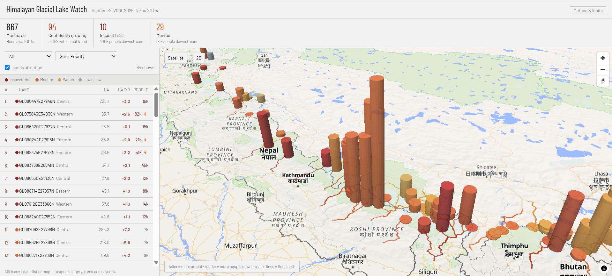
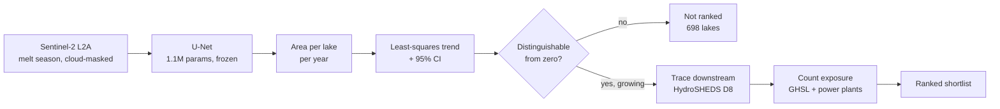
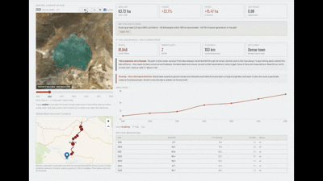

# NeerRikshan — Himalayan Glacial Lake Watch

**Which growing glacial lakes should someone look at first?**

Glacial lakes grow as glaciers retreat. When one breaches its moraine dam the result is a
glacial lake outburst flood — South Lhonak, Sikkim, October 2023: dozens dead and the
1,200 MW Teesta III dam destroyed. The public inventories that track these lakes are
**episodic snapshots**, and the widely used Hi-MAG baseline **ends in 2017**.

This project extends that to an **annual, per-lake area series for 867 Himalayan lakes
(2019–2025)**, attaches a **confidence interval** to every trend, and traces each growing
lake **downstream** to count who lives in the path.



---

## The result

```
867 lakes monitored
    ↓  trend must beat its own year-to-year noise
152 with a change distinguishable from zero   (82% are not — and we say so)
    ↓  growing, not shrinking
 94 confidently growing
    ↓  and people live downstream
 10 "inspect first"     29 "monitor"     14 above hydropower
```

Turning **867 lakes into a 10-lake shortlist** is the deliverable. Everything else is the
evidence that the shortlist is trustworthy.

| | |
|---|---|
| Segmentation IoU, **held-out** 93 lakes | **0.906** (recall 0.964) |
| MNDWI threshold baseline | 0.318 |
| Agreement with an **independent** inventory (watchlist) | **r = 0.68**, 88% sign agreement |
| Aggregate area change 2019→2025 | **+1.66%** |

---

## How it works



**Train once, then freeze.** The model is trained on 2022 imagery with epoch-matched 10 m
labels, then frozen and applied to every year. If the model changed between years, a change
in area could be a change in the model rather than the lake — freezing it is what makes
2019 and 2025 comparable.

**Windows are sized to each lake.** A fixed 1.28 km frame clipped every lake over 100 ha,
so their growth read as *exactly zero*. Sizing the window to the lake's real extent fixed
it — see [EXPERIMENTS.md](EXPERIMENTS.md#fitted-windows--matched-epoch-labels--the-truncation-fix).

---

## Per-lake view

Every ranked number is checkable by eye: year-by-year imagery with the model's outline,
the fitted trend, and the traced flood path with the settlements on it.



---

## What makes the numbers trustworthy

- **Validated against data we never trained on.** Scored against an independent 10 m
  inventory (Kumar & Vijay 2026): IoU **0.846**, precision **0.943** — *higher* than
  against our own training labels, because those labels were 30 m Landsat and ~8% small.
- **Validated against a real event.** Tracing downstream from South Lhonak reproduces the
  actual 2023 GLOF path — 5,200 m → 274 m over 150 km, exiting where the Teesta leaves the
  hills, finding **49,997 people** and **510 MW** in the corridor.
- **Uncertainty is reported, not hidden.** A lake is ranked only if its 95% CI excludes
  zero. 82% of lakes fail that test and are excluded rather than dressed up.
- **The failures are written down.** [DECISIONS.md](DECISIONS.md) records the wrong turns:
  a net-shrinkage result that turned out to be a model artifact, an ablation that disproved
  the project's own premise, and bugs that would have silently corrupted the output.

---

## What this is **not**

> This lake is changing, and if an outburst occurred, these are the downstream areas
> potentially exposed.

It is **not** a GLOF forecast. Risk requires a *probability of outburst*, and none of its
determinants are measured here — moraine geometry and freeboard, ice-core degradation, lake
depth and volume (we see surface area only), avalanche potential above the lake, triggers,
breach hydraulics. A high score means *worth looking at*. A low score is **not** a safety
certificate.

Other limits, stated plainly:

| limit | consequence |
|---|---|
| Six-year window | signal ~0.3 %/yr vs 2.8% scatter → only 18% of lakes give a usable trend |
| Absolute areas read ~15% high | proportional, so **rates** are unaffected |
| Lakes ≥10 ha only | ~17% of the inventory; the median glacial lake is 2.9 ha |
| Optical only | monsoon months unusable; SAR would see through cloud |
| Growth slowed after 2022 | +1.02 %/yr (2019–22) → +0.42 %/yr (2022–25), reproduced by two independent models |

---

## Quickstart

```bash
git clone https://github.com/<your-username>/NeerRikshan.git
cd NeerRikshan
```

**Backend** — the API reads committed JSON artifacts, so this runs with no Earth
Engine account and no GPU:

```bash
cd server
python -m venv .venv
source .venv/bin/activate        # Windows: .venv\Scripts\activate
pip install -r requirements.txt
cp .env.example .env             # leave GEE_PROJECT blank — not needed to browse the results
python -m uvicorn app.main:app --port 8011
```

**Frontend**, in a second terminal:

```bash
cd client
npm install
echo "VITE_API_BASE_URL=http://localhost:8011" > .env
npm run dev
```

Open the printed `localhost` URL — the full watchlist, map and per-lake pages are
live against the committed data.

Only regenerating the pipeline outputs yourself needs Earth Engine:
1. Register a Cloud project at [console.cloud.google.com/earth-engine](https://console.cloud.google.com/earth-engine)
   (noncommercial is free, no billing required)
2. Run `earthengine authenticate` once — this caches a login outside the repo
3. Set `GEE_PROJECT=<your-project-id>` in `server/.env`

```bash
python -m scripts.plan_windows                                    # window per lake
python -m scripts.export_patches --split all --year 2025 --fit    # imagery
python -m scripts.run_inference --model ndwi_fit_kv22 --fit       # area per lake-year
python -m scripts.detect_change --min-years 4                     # trends + CIs
python -m scripts.trace_downstream --max-km 100                   # flood corridors
python -m scripts.downstream_settlements                          # who is in them
```

---

## Repository

```
server/
  app/routers/lakes.py        API over the committed artifacts
  scripts/train_unet.py       model + training
  scripts/export_patches.py   Earth Engine → training patches
  scripts/run_inference.py    frozen model → area per lake-year
  scripts/detect_change.py    trends, standard errors, 95% CIs
  scripts/trace_downstream.py HydroSHEDS D8 routing + exposure
  scripts/eval_vs_kv.py       scoring against an independent inventory
client/src/
  pages/LakeOverview.jsx      ranked list + 2D/3D map
  pages/LakeDetail.jsx        imagery, trend, downstream panel
EXPERIMENTS.md                every experiment, including the ones that failed
DECISIONS.md                  engineering log: wrong turns and what they cost
```

---

## Data

| source | use | licence |
|---|---|---|
| [Sentinel-2 L2A](https://developers.google.com/earth-engine/datasets/catalog/COPERNICUS_S2_SR_HARMONIZED) | imagery | Copernicus open |
| [Hi-MAG](https://essd.copernicus.org/articles/13/741/2021/) | 2017 lake baseline | CC-BY-4.0 |
| [Kumar & Vijay 2026](https://doi.org/10.5281/zenodo.17948783) | 10 m labels + validation | CC-BY-4.0 |
| [HydroSHEDS](https://www.hydrosheds.org/) | downstream routing | free for non-commercial |
| [GHSL](https://human-settlement.emergency.copernicus.eu/) | population, settlements | open |
| [WRI Global Power Plant DB](https://datasets.wri.org/datasets/global-power-plant-database) | hydropower exposure | CC-BY-4.0 |

Built with PyTorch, Google Earth Engine, FastAPI, React and MapLibre GL.
